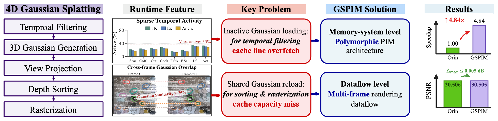

<h1 align="center">
GSPIM: A Temporal-Locality-Aware 4D Gaussian Splatting Accelerator<br>
with Polymorphic PIM and Multi-Frame Rendering Dataflow
</h1>

<p align="center">
Zirui Ma · Zhihua Fan · Haibin Wu · Dongrui Fan · Xiaochun Ye · Wenming Li
</p>

<p align="center">
<a href="#installation">Installation</a> ·
<a href="#data-and-models">Data &amp; Models</a> ·
<a href="#evaluation">Evaluation</a> ·
<a href="https://github.com/MAdrid1011/GSPIM/releases/tag/checkpoints-v1.1">Checkpoints</a> ·
<a href="#documentation">Documentation</a>
</p>

<p align="center">

</p>

GSPIM accelerates dynamic Gaussian splatting on Jetson AGX Orin by combining
Polymorphic PIM, multi-frame rendering, and overlapping GPU/PIM execution.
This repository provides the CUDA implementation, PPIM/HCF hardware source,
and evaluation pipeline for 4DGS-1K, Ex4DGS, and Anchored 4DGS across six scenes.

## Installation

The AGX Orin environment uses Ubuntu 24.04 / L4T R39.2, CUDA 13.2, Python 3.12,
and PyTorch 2.14.0+cu132. With CUDA installed and Conda available, run from the
repository root:

```bash
sudo apt-get install build-essential cmake ninja-build git zstd
conda create -n gspim --override-channels -c conda-forge python=3.12 pip ffmpeg=5.1.0 -y
conda activate gspim
export CUDA_HOME=/usr/local/cuda
export PATH="$CUDA_HOME/bin:$PATH"
python -m pip install torch==2.14.0 --index-url https://download.pytorch.org/whl/cu132
python -m pip install -e '.[cuda]'
```

The [AGX Orin setup guide](docs/setup.md) covers the software stack, automatic
CUDA builds, and storage on an external SSD.

## Data and models

Download the four checkpoint archives from [the v1.1 release](https://github.com/MAdrid1011/GSPIM/releases/tag/checkpoints-v1.1)
and extract them at the repository root to populate `checkpoints/`. They contain
all 18 model/scene combinations;
[Data preparation](docs/data.md#checkpoints) lists the files and extraction commands.

Preparation downloads Coffee Martini, Cook Spinach, Sear Steak, and Flame Steak.
Obtain Dance3 from [Mobile-Stage](https://docs.google.com/forms/d/e/1FAIpQLSeEbjuTV7w0lfryl-9FPX1VteuPGkbqjDvxXebY02Tm6BMejQ/viewform?usp=sf_link)
and Actor1_4 from [ENeRF-Outdoor](https://docs.google.com/forms/d/e/1FAIpQLSeFAgcnJEDYEaco4vA2QsD-bM8V8CRFuiR0QWbi_3uXmXtUKg/viewform?usp=sf_link).
Place `dance3_libx265.tar.gz` and `actor1_4_libx265.tar.gz` in
`~/.cache/gspim/downloads/`, or `<cache>/downloads/` when using `--cache`.

## Evaluation

Prepare the inputs and evaluate all 18 combinations through the main entry:

```bash
python -m gspim.demo --prepare
python -m gspim.demo
```

For efficient execution and lower trace-storage requirements, the default run
uses 10 frames per scene, with 100 warmup windows and four measurement
repetitions. The paper evaluates 300-frame sequences, with 200 frames for
Actor1_4. A ±5% relative difference in speedup is the reference tolerance for
comparing the shorter run with the paper's evaluation.

Generate the full-sequence quality table with:

```bash
python -m gspim.demo --frames 300 --out outputs/quality
```

The terminal displays stage progress and the four speedups as each combination
finishes. [Running](docs/running.md) describes frame selection, cache reuse,
and evaluation of individual models and scenes.

## Results

| Output | Contents |
| --- | --- |
| `outputs/verification.md` | Speedup and PSNR/SSIM tables for all combinations |
| `outputs/performance.{png,pdf}` | Dataflow and Full GSPIM speedups |
| `outputs/ablation.{png,pdf}` | Dataflow, PIM-only, Serial, and Full GSPIM speedups |
| `outputs/<model>/<scene>/summary.md` | Results for one model and scene |

Use `--cache /path/to/ssd/cache` and `--out /path/to/ssd/results` to keep build
files, traces, and results on an external disk. Model labels in figures are
`1K`, `Ex`, and `Anch.`.

## Documentation

| Guide | Contents |
| --- | --- |
| [Setup](docs/setup.md) · [Data](docs/data.md) · [Running](docs/running.md) | AGX Orin installation, inputs, and evaluation |
| [Workloads](docs/workloads.md) · [GPU dataflow](docs/dataflow.md) | Model representations and CUDA rendering |
| [Architecture](docs/architecture.md) · [Runtime](docs/runtime.md) | PPIM/HCF hardware and GPU/PIM scheduling |

Rendering and scheduling live in `gspim/`, checkpoint adapters in `integrations/`,
training source in `gspim/training/`, and RTL in `hardware/`. Independent algorithm
references and functional checks are in `reference_model/` and `tests/`.

## Acknowledgments

GSPIM builds on [gsplat](https://github.com/nerfstudio-project/gsplat),
[original 4DGS](https://github.com/LogosIntelligenceLab/4d-gaussian-splatting),
[Ex4DGS](https://github.com/juno181/Ex4DGS), and
[Ramulator2](https://github.com/CMU-SAFARI/ramulator2).
See [LICENSE](LICENSE) and [Third-party notices](THIRD_PARTY_NOTICES.md).
